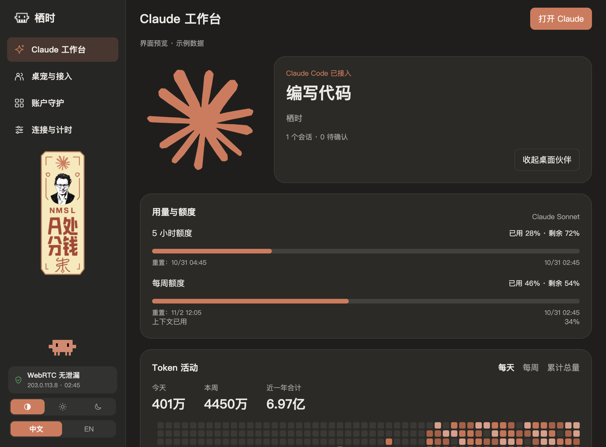
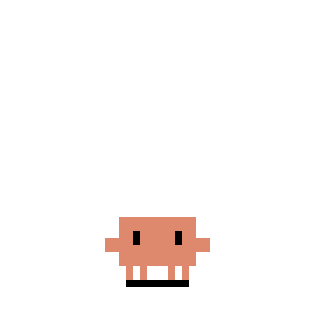
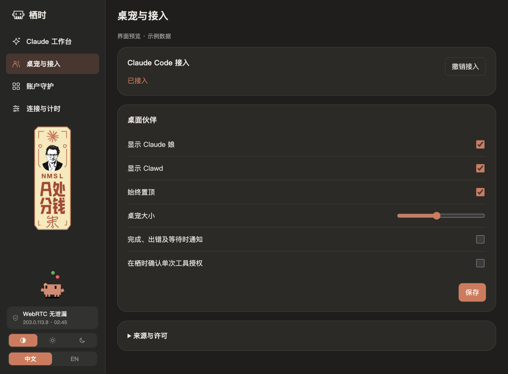
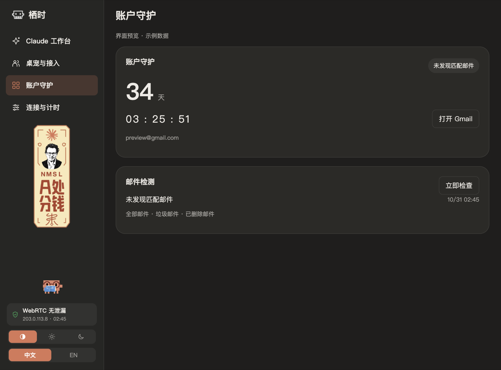

<div align="center">


# 栖时·Claude

**住在桌面上的 Claude Code 伙伴：Claude 娘与 Clawd 小螃蟹跟着 Claude 一起工作。**

原生 macOS Liquid Glass 工作台 · Token 活动热力图 · 额度追踪 · 桌宠 · WebRTC 泄漏检测

[](https://github.com/SlxBYR/qishi-claude/releases)
[](LICENSE)


[](https://github.com/SlxBYR/qishi-claude/stargazers)

2.2.1（build 31）



</div>

> [!WARNING]
> **项目状态：半成品。** 这是一个仍在开发中的半成品，不是正式版本。功能、界面和数据格式随时可能变化，可能存在未发现的问题。
> Windows 版目前只在 macOS 上做过隔离预览，尚未在 Windows 实机完整验证；macOS 版也未经过真实 Gmail 与 Claude 账号的完整验收。
> macOS 包为本机临时签名（未经 Apple 公证），首次打开需在“系统设置 › 隐私与安全性”中允许，或右键选择“打开”。Windows 包未签名，SmartScreen 可能提示，需选择“仍要运行”。
> 欢迎试用和反馈，但请勿将其用于重要场景。

> [!IMPORTANT]
> **Clawd 素材授权申请中。** 本项目中的 Clawd 动画与美术来自 [clawd-on-desk](https://github.com/rullerzhou-afk/clawd-on-desk)，动画作者：鹿鹿（[@rullerzhou-afk](https://github.com/rullerzhou-afk)）。这些素材保留全部权利、不在 AGPL-3.0 范围内，目前正在向作者申请非商业使用、改编与随项目分发的许可；在获得同意之前，请勿再分发或改编这些素材。如作者不同意，将第一时间替换或移除。详见下文“素材与来源”。
>
> **Clawd artwork permission pending.** The Clawd animations and artwork come from [clawd-on-desk](https://github.com/rullerzhou-afk/clawd-on-desk), animated by [@rullerzhou-afk](https://github.com/rullerzhou-afk). They are all rights reserved and not covered by AGPL-3.0. Permission for non-commercial use, adaptation and redistribution has been requested from the author; please do not redistribute or adapt them until it is granted. If the author declines, they will be replaced or removed right away.

## 下载

[GitHub Releases](https://github.com/SlxBYR/qishi-claude/releases) 提供 macOS（.dmg，Apple 芯片，macOS 27+）与 Windows（单文件便携 .exe 或 .zip，x64）安装包。

原生 macOS Claude 工作台与独立 Windows 桌面端，基于用户提供的栖时源码整合。macOS 版支持 Apple 芯片，最低 macOS 27，无需额外安装 Python、Node 或 Electron。Windows 版为独立的 Windows 10/11 x64 便携程序，见 [Windows/README.txt](Windows/README.txt)。

## 主要功能

### 桌面伙伴：Claude 娘 + Clawd

<table>
<tr>
<td align="center"><br><sub>待机</sub></td>
<td align="center"><br><sub>思考</sub></td>
<td align="center"><br><sub>写代码</sub></td>
<td align="center"><br><sub>Clawd 打字</sub></td>
<td align="center"><br><sub>蹦跳</sub></td>
<td align="center"><br><sub>比心</sub></td>
</tr>
</table>

桌面上 Claude 娘与 Clawd 小螃蟹同屏，跟随思考、阅读、写代码、运行、搜索、子任务、等待、压缩、完成、出错和休息状态切换动作。

- 桌面小螃蟹使用 Clawd on Desk 原始 SVG、原始 renderer.js 与样式；支持眼神跟随、点击、拖拽、待机、睡眠和贴边。
- Claude 娘以 CrossPet 动作逻辑、effects.js 特效和全部 60 张原图为基础，保留呼吸摆动、眨眼、摸头、甩晕、生气、节日动作与多任务表演。
- Claude 娘拖动只移动角色；拖到屏幕边缘时静态贴边（显示贴边原画、半藏），不再播放探出、收回或挥手动画，悬停也不会探出。
- Claude 娘与 Clawd 可分别显示或隐藏（菜单栏、“桌宠与接入”或右键角色），也可分别拖动、记忆位置、调整大小、置顶；移除桌面标签、额度条与常驻按钮；点击 Claude 娘显示 CrossPet 风格的账号存活天数气泡。
- 顶栏 Clawd 图标在 Claude 工作（思考、阅读、写代码、运行、搜索、子任务、整理上下文）时原地行走，空闲、等你回应、完成或出错时回到静态标志；行走帧沿用同一套描边网格，匀速播放，参照 RunCatNeo 用 Core Animation 关键帧遮罩实现，不靠定时器重绘。可在顶栏菜单或“桌宠与接入”关闭；系统开启“减弱动态效果”时保持静态。
- 侧栏底部是 Clawd 小螃蟹，在原版动画与栖时新绘的 6 段动画（蹦跳、挥手、张望、横着走、比心、哼歌）之间随机播放，点一下换一段。

### Claude 工作台

页首截图就是 Windows 端的工作台：左侧 Claude 标志动画，右侧状态卡片，下方是用量与额度和 Token 活动热力图。

- 工作台左侧是独立的 Claude 标志动画：中心与各道光芒的根部固定不动，光芒外段从根部缓慢伸缩（周期约 7–11 秒、节奏互不相同），标志始终连成一体；Claude 工作时稍快。右侧玻璃卡片显示状态。
- 会话列表只显示最近 5 个有过工具调用的会话（0 次工具调用的会话隐藏）；并行工具和子任务跟踪、打开项目文件夹。
- 可选完成 / 出错 / 等待通知，可选单次工具授权浮窗，允许一次、拒绝或交回 Claude。

### 用量、额度与 Token 活动

- **额度**：Claude Code 官方状态栏上报的 5 小时、每周和可选支出额度；上下文用量、更新时间与过期标记。
- **Claude Desktop 额度静默记录**（并入“用量与额度”）：仅在 Claude Desktop 运行时，每 20 秒检查一次它自己写在本机的用量记录（`~/Library/Application Support/Claude/plan-usage-history.json`），文件有变化才读取；只取时间与 5 小时、每周百分比，组织标识只存哈希，合并保存到数据目录的 `desktop-usage-history.json`（明文，最长 400 天），近 7 天可展开为趋势图与明细。不联网、不抓包、不用辅助功能、不操作窗口、不读取登录凭据、不写入 Claude 的任何文件。“用量与额度”中每项额度取两种来源里更新的一份并标注来源；Desktop 记录不含重置时间，只有与 Claude Code 上报处于同一窗口时才沿用其重置时间。记录何时更新由 Claude Desktop 自己决定（启动时，以及近 24 小时内打开过其用量面板时），可能比实际滞后；该文件格式属于 Claude 内部实现，变化时显示无法读取，不做猜测。
- **Token 活动**：读取本机 Claude Code 会话记录（`~/.claude/projects/**/*.jsonl`，支持 `CLAUDE_CONFIG_DIR`）中每条回复的用量字段，按消息去重、按本地日期汇总，以近一年日历热力图显示（每列一周、每行一天，主体色四档，按有用量日子的四分位分档），可切换每天 / 每周 / 累计总量；悬停格子显示日期与数值，另有今天 / 本周 / 近一年合计与近 14 天明细表。只读用量数字、时间与消息标识，不读取或保存对话正文，不联网；每 2 分钟增量刷新。

### 桌宠与接入



一键接入 Claude Code，分别控制两个桌宠的显示、置顶与大小，开关完成通知和单次工具授权（macOS 版另有顶栏行走图标开关）。接入细节见下文“接入行为”。

### 账户守护与 WebRTC 检测



- 保留栖时的注册计时、Gmail 只读邮件检测、提醒与菜单栏常驻。
- 侧栏同时显示 WebRTC 泄漏检测：用离屏 WebKit 打开 https://browserleaks.com/webrtc，读取“WebRTC Leak Test”结果与 WebRTC 公网 IP；启动时检测，之后每 5 分钟一次，点击状态可重新检测。结果不是 No Leak 时，Clawd 持续播放错误动画。

### 界面

- macOS 界面使用系统原生组件呈现 Liquid Glass：NavigationSplitView 浮动侧栏、窗口工具栏玻璃按钮、glassEffect 卡片与 glass / glassProminent 按钮。
- 浅色 / 深色 / 跟随系统三种外观与中文 / English 切换（工具栏“外观与语言”菜单）；主体色为 Claude 标志色 `#D97757`。侧栏选中底色跟随系统强调色。
- 精简主界面：移除装饰标语和重复说明，来源与许可可展开查看。
- 侧栏导航下方显示一张海报（`Resources/Sidebar/poster.png`），只作展示，点按不切换页面。

> 以上截图来自 Windows 端，由 `npm run verify-ui` 使用示例数据渲染；macOS 版界面为原生 Liquid Glass 风格，布局略有不同。

## 开始使用

1. 打开“栖时·Claude.app”，直接出现两个透明桌宠，不弹出工作台。右键角色可摸头、戳一下、打开原有栖时功能或退出。
   点击桌面上的 Claude 娘可查看账号已存活天数；气泡 8 秒后自动收起，也可点击气泡关闭。
2. 首次接入时右键“打开栖时”，进入“桌宠与接入”，点击“接入 Claude Code”。
3. 重新开启 Claude Code 会话；如 Claude 要求信任钩子，在 Claude 内确认。
4. 发起任务，两个角色会跟随事件切换；额度在 Claude 的状态栏推送数据后出现。
5. 如需在栖时确认工具请求，再开启“在栖时确认单次工具授权”。该开关默认关闭。
6. 账号存活天数按“连接与计时”保存的注册时间计算，每满 24 小时增加 1 天；未设置时显示设置提示。此数值是注册时长，不是对账号可用性的实时验证。
7. Gmail 在“连接与计时”中设置；首次启动会复制旧栖时的非密码设置，并兼容读取旧钥匙串密码。新保存和删除使用独立的钥匙串条目，不删除旧版密码。

## 接入行为

- 更新 `~/.claude/settings.json`；若启动环境设置 `CLAUDE_CONFIG_DIR`，则使用该目录。
- 仅添加带 `--qishi-hook` 标记的钩子，并接入 `--qishi-statusline`。
- 已有钩子、权限、模型等设置保留；原有命令状态栏串行执行并保留输出（最长 3 秒）。
- 接入前保存 settings.json 完整备份。撤销仅移除本应用钩子，若状态栏仍由本应用管理则恢复原字段；后续用户改动保留。
- 工作桥接程序复制到独立数据目录，移动 App 不会让钩子路径失效。
- 不自动安装第三方插件，不修改 Claude 程序，不读取 Claude 登录凭据，不发起额外额度接口请求。

## 数据与授权

- 数据目录：`~/Library/Application Support/QishiClaude`
- 备份：该目录的 `Backups` 文件夹。
- 工作状态只留会话标识的哈希、项目路径、事件名、工具名、时间、计数与用量，不保存提示词、回复或会话正文。
- 授权开启后，为完整展示一次请求，参数会暂存在该目录的 `requests` 文件夹中；处理后删除，异常残留在下次启动时清理。
- 授权目录权限 0700，文件 0600；只支持明确的单次允许 / 拒绝，不新增永久权限规则。
- 未启动应用、关闭授权、超时、会话切换或应用退出时，不合成决定，交回 Claude 原生流程。
- 问题回答和计划确认仍在 Claude 内完成；没有自动批准功能。

## 额度与状态边界

- 额度取决于 Claude Code 实际上报或 Claude Desktop 自身记录；缺失就是未知，不能当成剩余 100%。
- 15 分钟未更新的额度标记为旧数据；到达重置时间后等待新的真实数据，不自行假定已重置。
- 5 分钟没有工作事件的忙碌会话显示“等待更新”，以免把历史状态当成实时工作。
- 普通 Claude 桌面聊天不提供此事件协议；本版本接入的是 Claude Code。

## 源码构建与测试

```bash
bash Scripts/build.sh
bash Scripts/test.sh
```

推送到 GitHub（公开仓库 SlxBYR/qishi-claude，提交全部改动后推送当前分支）：

```bash
bash Scripts/push.sh "提交说明"
```

仅运行桌宠回归（WebKit 静态贴边与原生贴边移动）：

```bash
bash Scripts/test.sh --motion-only
```

- Windows：在 `Windows/` 运行 `npm ci`、`npm test`、`npm run build`；也可运行 `Scripts/build-windows.ps1`。
- 默认生成 `../栖时·Claude.app`，编译缓存写入 `.build`。可通过 `QISHI_BUILD_DIR` 与 `QISHI_OUTPUT_DIR` 指定缓存和输出目录。
- 测试脚本需要 Node.js，并在已登录的 macOS 桌面会话运行真实 WebKit 与窗口检查。贴边截图默认写入 `.build/MotionVerification`，可通过 `QISHI_MOTION_TEST_OUTPUT` 修改路径。
- 桌宠测试覆盖静态贴边、悬停不探出、拖动与隐藏；脚本另外编译独立测试程序验证原生贴边移动中断及过期回调。
- Claude 标志图层由 `python3 Scripts/make-claude-logo.py` 从原图拆分（固定核心一层、每道光芒外段各一层并与核心重叠），输出到 `Resources/ClaudeLogo`。
- Clawd 新动画由 `python3 Scripts/make-clawd-animations.py` 在 Clawd 原始 15×16 像素网格上逐帧绘制（需要 Pillow），输出到 `Resources/Clawd/qishi-*.gif`。
- 使用完整 Xcode 可打开 `Qishi.xcodeproj`。主应用使用非沙盒签名以访问用户主动接入的 Claude 设置；WidgetKit 扩展仍需自己的开发团队及 App Group。
- 命令行交付版不嵌入系统 WidgetKit 扩展；双角色浮窗可以直接使用。

### 验证模式（不访问真实账号设置）

```bash
栖时·Claude.app/Contents/MacOS/Qishi --demo
栖时·Claude.app/Contents/MacOS/Qishi --demo --show-workbench
栖时·Claude.app/Contents/MacOS/Qishi --render-previews /绝对路径/预览
栖时·Claude.app/Contents/MacOS/Qishi --verify-companions /绝对路径/预览
```

界面预览会标明示例数据。正常启动不会显示示例额度。`ClaudeIntegrationTests.py` 使用隔离临时目录，不修改真实 `~/.claude`。

## 平台限制

- Windows 的托盘、通知、DPAPI、PowerShell、DPI、多屏与窗口生命周期尚未在 Windows 实机确认。
- 未使用真实 Gmail 或 Claude 账号验收，也未进行真实账号的付费模型调用验收。

## 素材与来源

| 来源 | 链接 | 固定版本 |
| --- | --- | --- |
| Clawd on Desk | https://github.com/rullerzhou-afk/clawd-on-desk | `834f2b83eb6c9725956c5c541b59f825b48b4b9a` |
| CrossPet | https://github.com/lokicorvus/crosspet | `5c64326b6e7fc175eda0360c0bb5c4732541d138` |
| 事件格式 | https://code.claude.com/docs/en/hooks | |
| 额度格式 | https://code.claude.com/docs/en/statusline | |

- Claude 娘素材：CrossPet / lokicorvus；社区 Claude 娘设定。保留 CC BY-NC-SA 4.0 授权，不可商用。
- 小螃蟹：动画素材来自 [clawd-on-desk](https://github.com/rullerzhou-afk/clawd-on-desk)，动画作者：鹿鹿（[@rullerzhou-afk](https://github.com/rullerzhou-afk)）。素材许可见 [assets/LICENSE](https://github.com/rullerzhou-afk/clawd-on-desk/blob/main/assets/LICENSE)（本仓库副本：`Resources/Clawd/LICENSE`）：保留全部权利，不可商用；clawd-on-desk 的 AGPL-3.0 是源码许可，不覆盖动画与美术素材，这些素材也不纳入本项目的 AGPL-3.0 许可。栖时新绘的 6 段小螃蟹动画与顶栏行走图标改编自上述素材，适用同一素材许可。
- Clawd 角色本身的权利归 Anthropic；以上署名不代表 Anthropic 的官方授权或背书。
- 本整合包按用户要求供个人本机使用；公开分发包含原版 Clawd 美术的整合应用前，须向权利人取得相应授权。
- 完整素材许可位于 `Resources/Claude/LICENSE.md` 与 `Resources/Clawd/LICENSE`，文件指纹见同目录 `manifest.json`。新增 Claude 娘拖动差分沿用原角色设定与素材授权。
- 非 Anthropic 官方应用。

## 许可

本项目源码以 GNU Affero General Public License v3.0（AGPL-3.0）发布，全文见 [LICENSE](LICENSE)。

项目内含并改编了 Clawd on Desk 的 AGPL-3.0 代码（`Resources/ClawdWeb`、`Upstream/clawd-on-desk`），整体分发只能沿用 AGPL-3.0，这也是上游授权允许范围内最开放的选择；CrossPet 的 MIT 代码与之兼容，原版权声明保留在 `Resources/CrossPet/LICENSE`。

AGPL-3.0 只覆盖源码，不覆盖动画与美术素材：Claude 娘立绘为 CC BY-NC-SA 4.0；Clawd 动画与美术（含栖时据此改编的动画和图标）以 clawd-on-desk 的 [assets/LICENSE](https://github.com/rullerzhou-afk/clawd-on-desk/blob/main/assets/LICENSE) 为准，保留全部权利、不可商用；侧栏海报由用户提供、权利归原作者。均以各自许可为准（见上文“素材与来源”）。

## 致谢

- 感谢 [CrossPet](https://github.com/lokicorvus/crosspet)（lokicorvus 与 CrossPet 贡献者）：桌面 Claude 娘的动作逻辑、effects.js 特效与全部角色立绘都来自这个项目。
- 感谢 [clawd-on-desk](https://github.com/rullerzhou-afk/clawd-on-desk)（动画作者：鹿鹿 [@rullerzhou-afk](https://github.com/rullerzhou-afk)，以及项目贡献者）：Clawd 小螃蟹的动画素材、renderer.js、样式与交互逻辑来自这个项目，栖时新绘的小螃蟹动画也画在它的原始像素网格上。

## Star 趋势

<a href="https://star-history.com/#SlxBYR/qishi-claude&Date">
  <picture>
    <source media="(prefers-color-scheme: dark)" srcset="https://api.star-history.com/svg?repos=SlxBYR/qishi-claude&type=Date&theme=dark" />
    <source media="(prefers-color-scheme: light)" srcset="https://api.star-history.com/svg?repos=SlxBYR/qishi-claude&type=Date" />
    
  </picture>
</a>
